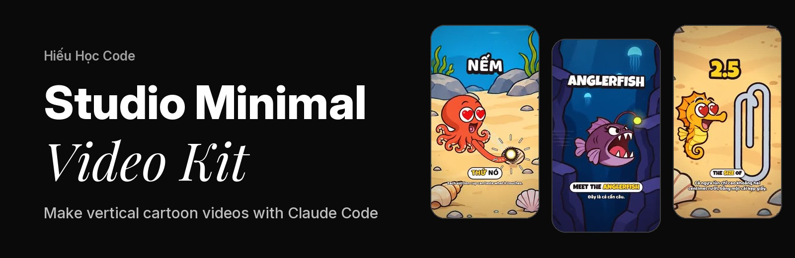

<p align="center">
  
</p>

<p align="center"><a href="README.md">Tiếng Việt</a> | <strong>English</strong></p>

# Studio Minimal Video Kit: make vertical cartoon videos with Claude Code

A free Claude Code skill that builds **one vertical 1080x1920 cartoon video** (TikTok, Reels, Shorts): a 2D character over illustrated backgrounds, a voiceover, big titles and captions that follow each word. You name a topic, Claude writes the script, shows you every scene for approval, and only then renders.

It ships with a 15-second sample video, "An octopus has three hearts", so you can run it right away.

> **Want the full version?** [Edit Kit](https://hieuhoccode.com/san-pham/edit-kit?nguon=repo-en) adds word timing aligned to the real voice, batch character image generation, sound effects, thumbnails and an effects pack for talking-head clips. The product page is in Vietnamese.

The frames in the header come from videos I have published, made with the full Studio Minimal kit and artwork I prepared myself. This repo ships a code-drawn octopus sample for a test run; how good your video looks depends on the images you bring.

## Read this first

This kit was built for Vietnamese creators:

- `SKILL.md` and the sample script are written in Vietnamese, and the skill tells Claude to answer in Vietnamese. Tell Claude which language you want and it will follow you.
- The automatic voiceover uses the macOS Vietnamese system voice "Linh". For another language, put your own recording at `assets/audio/vo.wav` and run `python3 tools/fake_words.py` for estimated word timing.
- Captions use the Baloo 2 font, which covers Latin and Vietnamese.

## Install (one line)

```bash
git clone https://github.com/nguyentrunghieutcu/studio-minimal-video-kit ~/.claude/skills/studio-minimal-video-kit
```

Or paste this into Claude Code and let it install the skill:

```text
Install the skill at https://github.com/nguyentrunghieutcu/studio-minimal-video-kit into ~/.claude/skills/studio-minimal-video-kit, then tell me what it needs to download before you run setup.sh.
```

On first use the skill runs `setup.sh`: it creates its own Python environment inside the skill folder and downloads the Chromium browser and the Baloo 2 font. You need a network connection and about 600 MB of disk space.

## Use it

Open a new Claude Code session in the folder where you want your videos, then say:

```text
Render the octopus sample video so I can see it.
```

```text
Make a 20-second video about why cats purr. Reply in English.
```

Claude works in order: script, scene plan, voiceover, a preview sheet with one frame per scene, your approval, then the MP4. Step-by-step guide with prompts (in Vietnamese): [hieuhoccode.com/huong-dan/studio-minimal-video-kit](https://hieuhoccode.com/huong-dan/studio-minimal-video-kit?nguon=repo-en).

## What you need

| Item | Requirement |
| --- | --- |
| Operating system | **macOS** (tested). Linux and Windows are untested; the automatic voiceover command is macOS only. |
| Claude Code | A version that loads skills from `~/.claude/skills`. |
| ffmpeg | Required, on your `PATH` (`brew install ffmpeg`). |
| Python | 3.9 or newer. `setup.sh` prefers 3.12. |
| Voice | The macOS Vietnamese voice "Linh", or your own audio file. |

## Free version and Edit Kit

| Part | This repo (free) | Edit Kit (paid) |
| --- | --- | --- |
| Cartoon renderer (character, backgrounds, titles, captions, zoom, shake) | Yes, reduced | Full version with more props |
| Runnable sample video | One 15-second video | More examples |
| Voiceover | macOS system voice, or your own file | Workflow for a professional voice service |
| Word timing | Estimated from sentence length | Aligned with Whisper |
| Batch character and background image generation | No, you bring the images | Yes, with prompt templates |
| Automatic background removal | No | Yes |
| Sound effects and music | No | Yes |
| Thumbnails | No | Yes |
| Vietnamese dub from an English video | No | Yes |
| Effects for talking-head clips | No | Yes |

## Honest notes

- The character is a still pose with a light wobble, not frame-by-frame animation.
- The sample art is drawn in code and exists only for a test run.
- Word timing is an estimate; long sentences drift more.
- The facts in the sample video are for illustration. Check your own content before you post.

## Tested

On 20 November 2026, macOS, from a clean copy of this repo: `setup.sh`, the "Linh" voiceover, the 6-scene preview sheet and the render all completed. Measured with ffprobe: MP4, 1080x1920, 60 frames per second, H.264 and AAC, 15.4 seconds long.

Not tested: Windows, Linux, voices in other languages, and Claude Code picking up the skill on a machine other than the author's.

## If something breaks

- `setup.sh` fails while installing packages: your Python is too new. Run `brew install python@3.12` and try again.
- The video has no sound: the video folder has no `assets/audio/vo.wav`. Run the voiceover step again.
- Text shows empty boxes: the Baloo 2 font is missing. Run `setup.sh` again.

## Licence

Free for your own videos, commercial ones included. You may modify it and share it for free with credit. **You may not resell it** or bundle it into a paid product. The binding text is in Vietnamese: [LICENSE.md](LICENSE.md).

## Author

Hiếu Học Code, [hieuhoccode.com](https://hieuhoccode.com/?nguon=repo-en). New videos on TikTok and Threads: @hieu.modoro.
