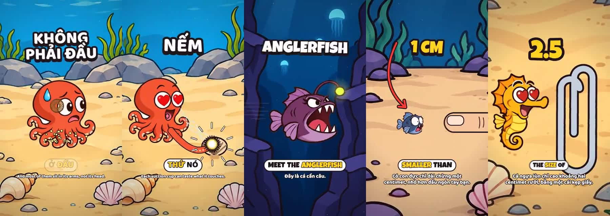

# Studio Minimal Video Kit: dựng video hoạt hình dọc bằng Claude Code

Skill miễn phí cho Claude Code để dựng **một video hoạt hình dọc 1080x1920** (TikTok, Reels, Shorts): nhân vật 2D trên nền minh hoạ, giọng đọc tiếng Việt, tiêu đề lớn và phụ đề chạy theo từng từ. Bạn nói chủ đề, Claude viết kịch bản, cho bạn duyệt từng cảnh rồi mới dựng.

Kèm sẵn video mẫu "Bạch tuộc có ba trái tim" dài 15 giây để chạy thử ngay.

> **Muốn bản đầy đủ?** [Edit Kit](https://hieuhoccode.com/san-pham/edit-kit?nguon=repo) có thêm căn từng từ theo giọng thật, sinh ảnh nhân vật hàng loạt, hiệu ứng âm thanh, ảnh bìa và bộ hiệu ứng cho clip quay mặt.



Khung hình từ các video mình đã đăng, làm bằng bộ Studio Minimal đầy đủ với hình nhân vật và nền mình tự chuẩn bị. Repo này kèm một mẫu bạch tuộc vẽ bằng mã để bạn chạy thử; video của bạn đẹp tới đâu tuỳ ảnh bạn đưa vào.

## Cài (một dòng)

```bash
git clone https://github.com/nguyentrunghieutcu/studio-minimal-video-kit ~/.claude/skills/studio-minimal-video-kit
```

Hoặc dán câu này vào Claude Code để nó tự cài:

```text
Cài skill ở https://github.com/nguyentrunghieutcu/studio-minimal-video-kit vào ~/.claude/skills/studio-minimal-video-kit, rồi cho mình biết cần tải thêm gì trước khi chạy setup.sh.
```

Lần đầu skill chạy `setup.sh`: tạo môi trường Python riêng trong thư mục skill, tải trình duyệt Chromium và font Baloo 2. Cần mạng và khoảng 600 MB ổ đĩa.

## Dùng

Mở một phiên Claude Code mới trong thư mục bạn muốn chứa video, rồi nói:

```text
Dựng video mẫu bạch tuộc để mình xem thử.
```

```text
Làm một video 20 giây về chủ đề: vì sao mèo kêu gừ gừ.
```

Claude làm theo thứ tự: viết kịch bản, lập kế hoạch cảnh, tạo giọng đọc, xuất ảnh xem trước mỗi cảnh một khung, chờ bạn duyệt, rồi mới dựng MP4. Hướng dẫn từng bước kèm prompt: [hieuhoccode.com/huong-dan/studio-minimal-video-kit](https://hieuhoccode.com/huong-dan/studio-minimal-video-kit?nguon=repo).

## Bạn cần gì

| Thành phần | Yêu cầu |
| --- | --- |
| Hệ điều hành | **macOS** (đã chạy thử). Linux và Windows chưa thử; lệnh tạo giọng đọc tự động chỉ có trên macOS. |
| Claude Code | Bản có hỗ trợ skill trong `~/.claude/skills`. |
| ffmpeg | Bắt buộc, có trong `PATH` (`brew install ffmpeg`). |
| Python | 3.9 trở lên. `setup.sh` ưu tiên 3.12. |
| Giọng đọc | Giọng tiếng Việt "Linh" của macOS. Chưa có thì vào Cài đặt hệ thống, Trợ năng, Nội dung nói để tải. |

## Bản miễn phí có gì, Edit Kit có thêm gì

| Phần | Repo này (miễn phí) | Edit Kit (trả phí) |
| --- | --- | --- |
| Bộ vẽ hoạt hình (nhân vật, nền, tiêu đề, phụ đề, zoom, rung) | Có, bản rút gọn | Bản đầy đủ, nhiều đạo cụ hơn |
| Video mẫu chạy được | Một video 15 giây | Nhiều ví dụ hơn |
| Giọng đọc | Giọng hệ thống macOS, hoặc file giọng của bạn | Quy trình dùng dịch vụ giọng đọc chuyên nghiệp |
| Căn thời gian từng từ | Ước lượng theo độ dài câu | Căn chính xác bằng Whisper |
| Sinh ảnh nhân vật và nền hàng loạt | Không, bạn tự đưa ảnh vào | Có, kèm mẫu prompt |
| Tách nền nhân vật tự động | Không | Có |
| Hiệu ứng âm thanh và nhạc nền | Không | Có |
| Ảnh bìa | Không | Có |
| Bản lồng tiếng Việt từ video tiếng Anh | Không | Có |
| Hiệu ứng cho clip quay mặt | Không | Có |

## Nói thật

- Nhân vật là hình đứng yên có uốn nhẹ, không phải hoạt hình vẽ từng khung.
- Hình mẫu vẽ bằng mã, chỉ để chạy thử. Video của bạn đẹp tới đâu tuỳ ảnh bạn đưa vào.
- Thời gian từng từ là ước lượng, câu dài sẽ lệch tiếng rõ hơn.
- Dữ kiện trong video mẫu chỉ để minh hoạ. Video thật bạn phải tự kiểm nội dung trước khi đăng.

## Đã chạy thử

Ngày 20/11/2026, macOS, từ một bản sao sạch của repo này: `setup.sh`, tạo giọng "Linh", ảnh xem trước 6 cảnh và dựng video đều chạy xong. Kết quả đo bằng ffprobe: MP4 1080x1920, 60 khung hình mỗi giây, H.264 và AAC, dài 15,4 giây.

Chưa kiểm: Windows, Linux, và việc Claude Code tự gọi skill trên máy khác máy tác giả.

## Khi gặp lỗi

- `setup.sh` báo lỗi khi cài gói: máy đang dùng Python quá mới. Cài `brew install python@3.12` rồi chạy lại.
- Video không có tiếng: chưa có `assets/audio/vo.wav` trong thư mục video. Chạy lại bước tạo giọng.
- Chữ hiện ô vuông: thiếu font Baloo 2. Chạy lại `setup.sh`.

## Giấy phép

Miễn phí cho video của bạn, kể cả video thương mại. Được sửa và chia sẻ lại miễn phí nếu ghi nguồn. **Không được bán lại** hay đóng gói vào sản phẩm thu tiền. Chi tiết: [LICENSE.md](LICENSE.md).

## Tác giả

Hiếu Học Code, [hieuhoccode.com](https://hieuhoccode.com/?nguon=repo). Video mới trên TikTok và Threads: @hieu.modoro.
